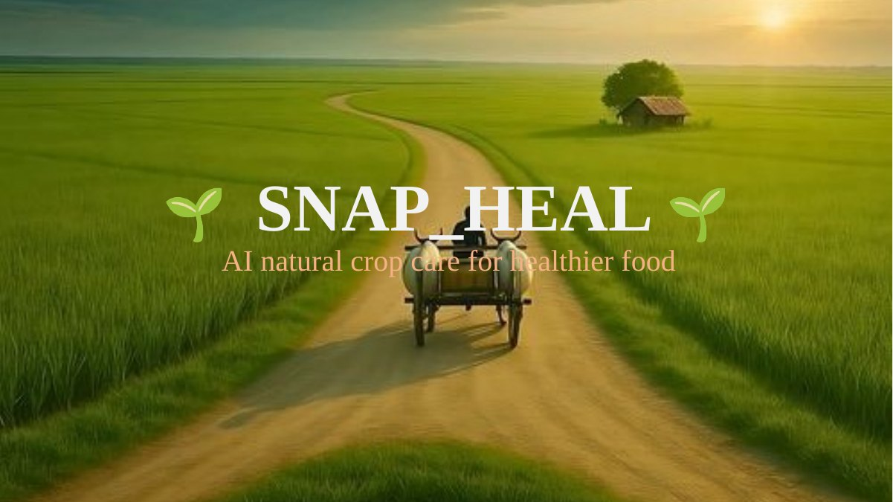
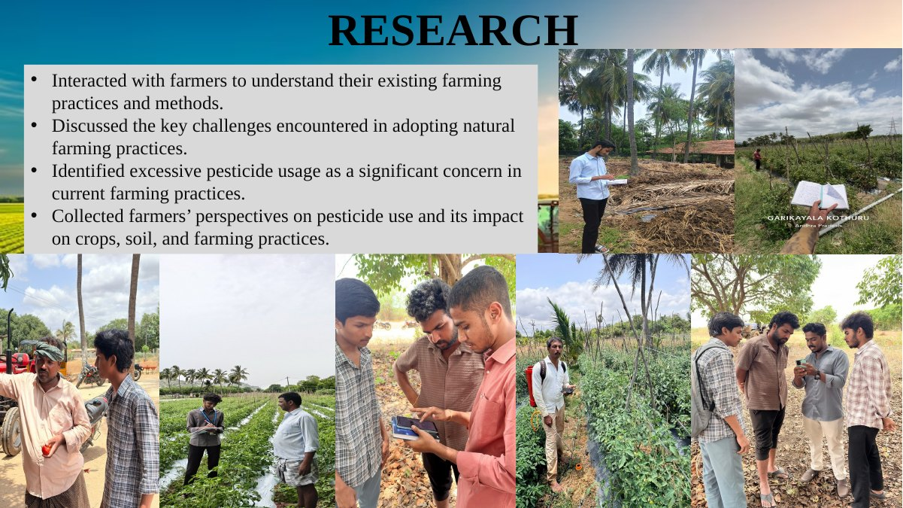
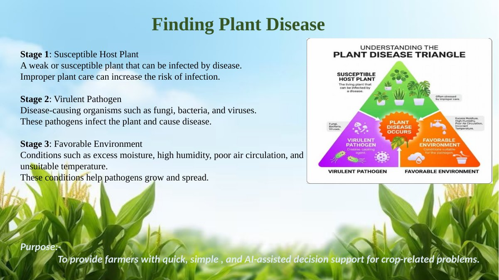
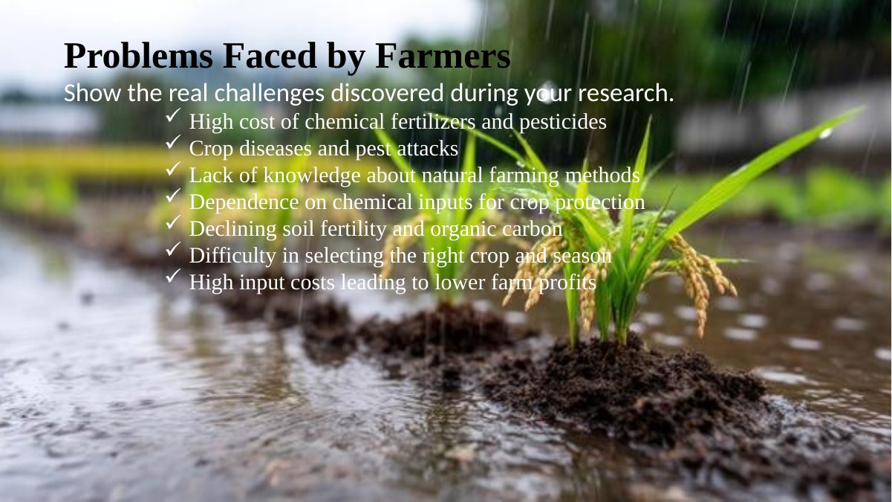
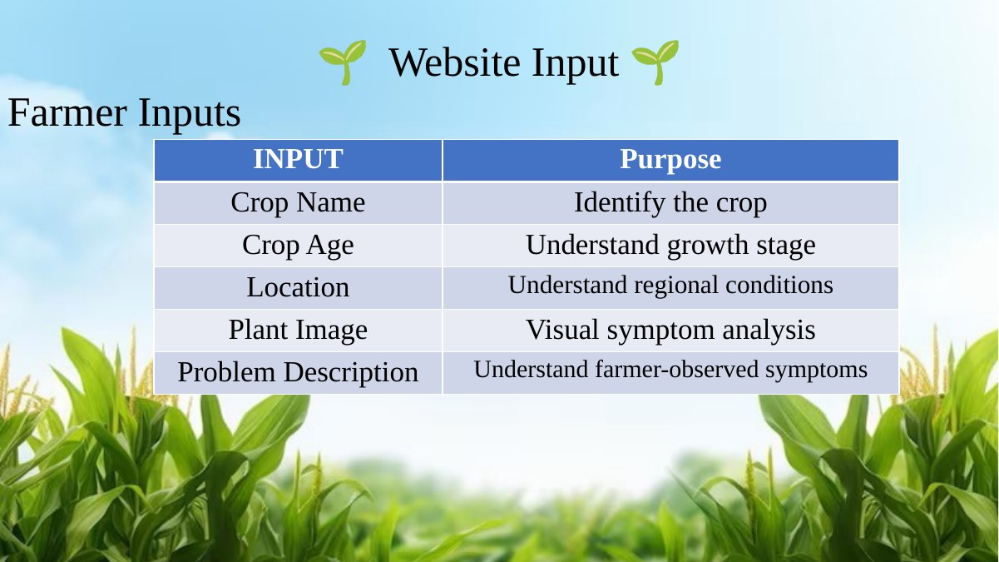
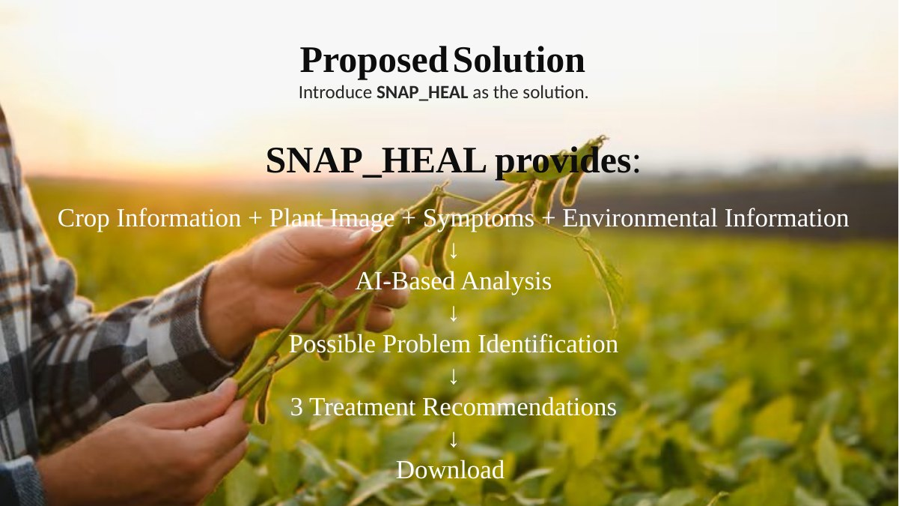
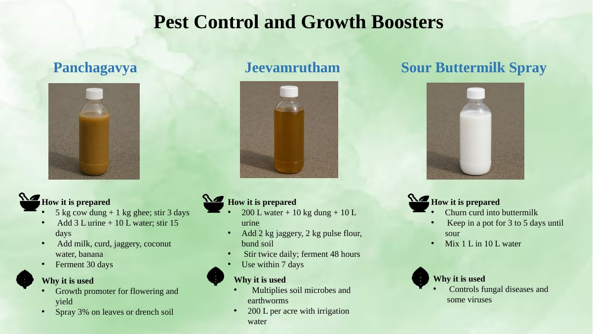
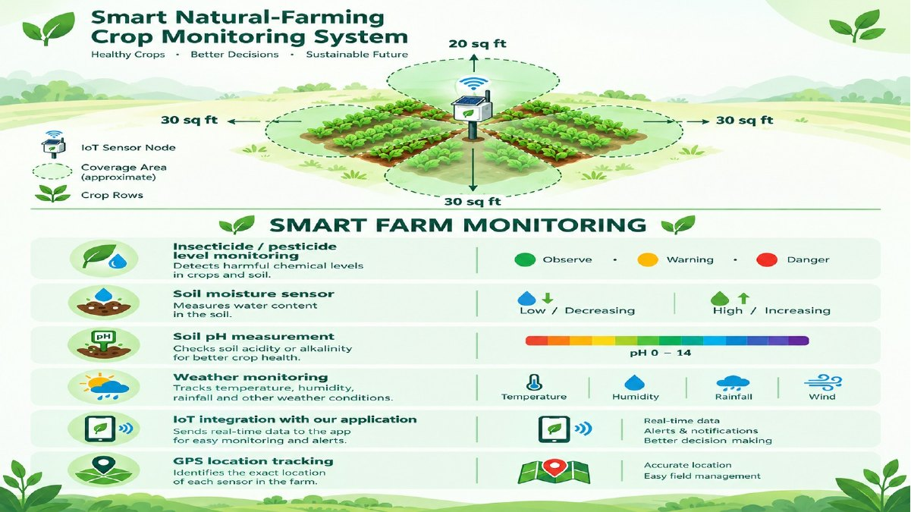
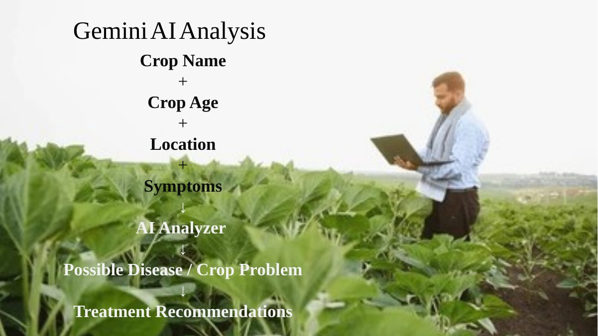
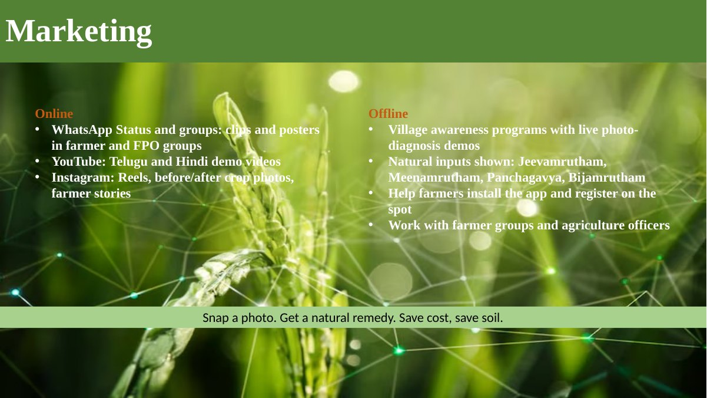

# 🌱 SNAP-HEAL

### Snap. Diagnose. Analyze. Grow Naturally.

**SNAP-HEAL** is an AI-assisted crop-care platform designed to help farmers investigate crop health problems, explore natural treatment options, and make more informed crop-planning decisions using soil and farm information.

It brings two complementary workflows together:

- **Crop Doctor** — crop health assessment and treatment guidance.
- **Crop Analyzer** — soil- and farm-aware crop suitability and recommendation support.

> **Project focus:** practical, research-informed crop-care guidance that encourages responsible farming decisions and helps farmers understand their options.

🌐 **Live application:** [https://snap-heal.onrender.com/](https://snap-heal.onrender.com/)




---

## 📌 Table of Contents

- The Problem
- Our Solution
- Core Modules
- How SNAP-HEAL Works
- Key Features
- Technology Stack
- System Architecture
- Getting Started
- Environment Configuration
- Security and Responsible Use
- Limitations
- Future Scope
- Contributing
- Project Team
- Disclaimer

---

## 🌾 The Problem

Farmers may face difficulty identifying crop-health problems at an early stage, choosing an appropriate response, and deciding which crop is suitable for their soil, water availability, and planting season.

Common challenges include:

- Uncertainty about visible crop symptoms, pests, and diseases.
- Limited access to timely, understandable crop-care information.
- Difficulty comparing natural treatment options and application guidance.
- Crop-planning decisions made without considering all relevant soil and farm conditions.
- The need for accessible guidance in a farmer-friendly format.

A single recommendation cannot fit every farm. Soil properties, crop stage, weather, irrigation, local practices, and the severity of a problem all matter.

### Research and farmer interactions

The project presentation documents farmer interactions and observations about existing practices, natural-farming adoption challenges, and concerns about pesticide use.



### Crop-health context

The presentation explains the plant disease triangle: a susceptible host, a disease-causing pathogen, and a favorable environment can interact to produce disease. It also lists farmer challenges such as crop disease, costly inputs, and limited access to natural-farming guidance.





## 💡 Our Solution

SNAP-HEAL combines AI-assisted crop-health analysis with farm-specific crop-planning support in one web application.

The platform is designed to help users:

1. Submit crop and farm information.
2. Review AI-generated analysis and recommendations.
3. Explore natural crop-care options and prevention practices.
4. Consider soil health, water resources, previous crops, and planting timing when evaluating crop choices.
5. Use a downloadable or printable advisory where that workflow is available.

SNAP-HEAL is a decision-support tool. It does not replace laboratory testing, qualified agricultural advice, or on-field verification.

---

## 🩺 Core Modules

### 1. Crop Doctor — AI-Assisted Crop Health

**Purpose:** Help farmers investigate possible crop diseases, pest damage, and crop stress from crop images and symptom information.

#### Typical workflow

1. Select or enter the crop name and relevant crop details.
2. Provide crop age, farm location, symptom information, and crop photos where requested.
3. Submit the information for AI-assisted analysis.
4. Review the possible issue and the generated explanation.
5. Explore natural treatment suggestions, preparation guidance, dosage or application details when provided, and prevention practices.
6. Save or print the advisory as a PDF when supported by the application.

#### Presentation visuals

The following slides illustrate the farmer inputs and the proposed Crop Doctor analysis flow.





#### Intended capabilities

- Crop image and symptom-based assessment.
- Possible disease, pest, or crop-stress identification.
- Natural treatment options and crop-care guidance.
- Prevention and follow-up recommendations.
- Farmer-friendly advisory output.

**Important:** Image-based analysis is an estimate, not a confirmed diagnosis. Image quality, crop variety, growth stage, and similar-looking symptoms can affect results.

### Natural farming inputs shown in the presentation

The presentation highlights Panchagavya, Jeevamrutham, and sour buttermilk spray as examples of natural-farming preparations. Their suitability and application should be validated for the specific crop and problem.



### 2. Crop Analyzer — Smart Crop Recommendation

**Purpose:** Support crop selection by considering soil health and farm conditions instead of relying only on a farmer's preferred crop.

#### Inputs

| Input                      | Why it matters                                                    |
| -------------------------- | ----------------------------------------------------------------- |
| Soil type                  | Helps assess broad soil suitability and drainage characteristics. |
| Soil pH                    | Provides an indication of soil acidity or alkalinity.             |
| Organic carbon             | Helps characterize an important aspect of soil health.            |
| Farm location and PIN code | Provides geographic context for local suitability.                |
| Farm area                  | Helps frame recommendations for the available land.               |
| Irrigation type            | Helps assess water-delivery constraints.                          |
| Water source               | Provides context for water availability.                          |
| Planting date              | Helps evaluate planting-time suitability.                         |
| Previous crop              | Supports crop rotation and cropping-history considerations.       |
| Desired crop, if entered   | Can be evaluated rather than automatically accepted.              |

#### Typical workflow

1. Enter soil test values and farm details.
2. Provide irrigation, water source, planting date, and previous crop.
3. Submit the form for AI-assisted evaluation.
4. Review the generated crop recommendation and its reasoning.
5. Compare the recommendation with local agricultural guidance and actual farm conditions before planting.

#### Concept visual from the presentation

The deck also includes a **Smart Natural-Farming Crop Monitoring System** concept covering soil moisture, soil pH, weather conditions, sensor connectivity, and GPS. Treat this as a concept/proposed direction unless those sensors and live integrations are confirmed in the deployed application.



#### Recommendation principles

A useful crop recommendation should consider, where reliable information is available:

- Soil suitability and soil-test results.
- Regional climate and planting season.
- Water availability and irrigation constraints.
- Crop duration and the previous crop.
- Expected yield, input costs, market demand, and profitability.
- Uncertainty and missing information.

These are decision criteria, not a guarantee that every factor is currently connected to a live external data source. Recommendations should not invent precise market prices, yields, or profits when reliable data is unavailable.

---

## 🔄 How SNAP-HEAL Works

```
                 Farmer / User
                       |
             SNAP-HEAL Web Application
                       |
             +---------+---------+
             |                   |
         Crop Doctor        Crop Analyzer
             |                   |
      Crop photos and      Soil and farm
      symptom details      information
             |                   |
             +---------+---------+
                       |
              Django Application
                       |
             AI service integration
                (Google Gemini)
                       |
             AI-generated analysis
                       |
             Farmer reviews results
                       |
        Crop-care / crop-planning guidance
```

The exact processing path depends on the selected module and the current application configuration. AI-generated output should be reviewed before any farm-level action is taken.

### AI analysis flow from the presentation



## ✨ Key Features

- **Two integrated workflows:** Crop Doctor and Crop Analyzer.
- **AI-assisted analysis:** uses submitted information to generate explanatory guidance.
- **Natural crop-care focus:** explores natural treatment and prevention options.
- **Farm-aware recommendations:** accepts soil, irrigation, location, and cropping-history details.
- **Responsive web interface:** designed for access through modern web browsers.
- **Voice-assisted form entry:** English, Telugu, and Hindi speech input where supported by the browser and device.
- **Advisory output:** printable or downloadable report support where available.
- **Decision-support approach:** recommendations should be assessed against local conditions and trusted agricultural advice.

Feature availability may depend on the deployed version, API configuration, browser support, and connectivity.

---

## 🛠️ Technology Stack

| Layer                  | Technology                                       |
| ---------------------- | ------------------------------------------------ |
| Backend                | Python, Django                                   |
| API layer              | Django REST Framework, where used                |
| AI integration         | Google Gemini API                                |
| Database               | SQLite3 in the current development configuration |
| Frontend               | Django templates, HTML, CSS, JavaScript          |
| Browser voice features | Web Speech APIs, where supported                 |
| Deployment             | Render                                           |

The table describes the known project stack. Update it if the repository uses a different production database, frontend framework, or deployment architecture.

## 🏗️ System Architecture

SNAP-HEAL follows a web-application architecture:

- **Presentation layer:** forms, crop-image upload, user feedback, and advisory display.
- **Application layer:** Django views and application logic for handling user inputs.
- **AI integration layer:** sends relevant prompts and inputs to the configured AI service and processes its response.
- **Data layer:** stores application data using the configured database where persistence is implemented.
- **Deployment layer:** serves the application through the configured hosting environment.

Keep API keys on the server. Do not expose secrets in browser JavaScript, public repositories, screenshots, or client-side configuration.

---

## 🚀 Getting Started

The following is a general setup guide for a Django-based repository. Adjust the project directory and settings module to match the actual repository.

### Prerequisites

- Python 3.10 or a version supported by the repository.
- `pip`.
- Git.
- A Google Gemini API key if AI features require it.
- The project's source code.

### 1. Clone the repository

Replace the placeholder with the actual Git repository URL:

```
git clone https://github.com/gnaneswaryadav20/Snap-Heal.git
cd Snap-Heal
```

### 2. Create and activate a virtual environment

**Windows (PowerShell):**

```
python -m venv venv
.\venv\Scripts\Activate.ps1
```

**Windows (Command Prompt):**

```
python -m venv venv
venv\Scripts\activate
```

**Linux / macOS:**

```
python3 -m venv venv
source venv/bin/activate
```

### 3. Install dependencies

If the repository contains a `requirements.txt` file:

```
python -m pip install --upgrade pip
pip install -r requirements.txt
```

If it does not, install the dependencies documented by the project rather than assuming a package list.

### 4. Configure environment variables

Create a local `.env` file if the project is configured to load one, or set environment variables through your operating system or hosting dashboard. See Environment Configuration.

### 5. Apply database migrations

```
python manage.py migrate
```

### 6. Run the development server

```
python manage.py runserver
```

Open `http://127.0.0.1:8000/` in your browser.

If your project uses a different Django settings module, dependency manager, or startup command, follow the repository's existing configuration.

---

## 🔐 Environment Configuration

AI features may require a Gemini API key. Configure secrets in your local environment or hosting provider.

Example variable name:

```
GEMINI_API_KEY=your_api_key_here
```

This is an example only. Use the exact variable name expected by the code in your repository. Do not commit real API keys or secret values.

Recommended practices:

- Add `.env` to `.gitignore`.
- Keep a safe `.env.example` containing variable names and placeholder values only.
- Store production secrets in the hosting provider's environment-variable settings.
- Rotate any key that has been exposed publicly.
- Restrict uploads by file type and size, and validate uploaded content on the server.

---

## 🛡️ Security and Responsible Use

- Validate and sanitize user inputs on the server.
- Restrict crop-image uploads to supported image types and reasonable file sizes.
- Keep API credentials and other secrets out of source control.
- Use HTTPS in production and configure Django's production security settings.
- Configure `DEBUG = False` and set `ALLOWED_HOSTS` appropriately in production.
- Avoid collecting personal or farm information that is not needed for the service.
- Explain how submitted images and farm data are handled in the application's privacy notice.
- Treat AI output as advisory, not as a guaranteed diagnosis or outcome.
- Follow local agricultural guidance, product labels, and applicable regulations before applying any treatment.

## ⚠️ Limitations

- AI can misidentify diseases, pests, nutrient deficiencies, or environmental stress.
- A photograph alone may not provide enough evidence to distinguish similar symptoms.
- Soil recommendations depend on the accuracy and freshness of entered soil measurements.
- Recommendations can be less reliable when local climate, rainfall, water quality, or market data is missing.
- Browser-based voice input varies by browser, device, permissions, and network conditions.
- A generated report does not independently validate the recommendation.
- No specific yield, income, disease-control result, or reduction in chemical use is guaranteed.

---

## 🔭 Future Scope

Potential enhancements, subject to development and validation:

- Weather and rainfall integration using trusted data sources.
- Soil-testing laboratory or verified soil-health data integration.
- Regional crop calendars and locally validated agricultural recommendations.
- Telugu-first and other regional-language experiences.
- Field trials comparing recommended approaches with observed outcomes.
- Optional IoT sensor integration for soil moisture and environmental measurements.
- Crop history, saved advisories, and farmer feedback.
- Verified market-price and input-cost data for transparent economic comparisons.
- Expert review workflows with agricultural professionals.
- Analytics to evaluate recommendation quality and real-world outcomes.

These are proposed improvements and should not be interpreted as already implemented unless confirmed in the repository.

## 📣 Farmer Awareness and Adoption

The presentation proposes online outreach through WhatsApp, YouTube, and Instagram, alongside offline village awareness demonstrations, showcasing natural inputs, and collaboration with farmer groups and agriculture officers.



The deck's closing message is: **“Snap a photo. Get a natural remedy. Save cost, save soil.”**

## 🤝 Contributing

Contributions that improve usability, accessibility, testing, documentation, security, and agricultural reliability are welcome.

1. Fork the repository.
2. Create a feature branch.
3. Make a focused change.
4. Run relevant tests and check the application locally.
5. Submit a pull request describing the change and its validation.

For agricultural recommendations, contributors should provide reliable references and clearly identify assumptions and limitations.

## 👥 Project Team

** AGROVEX **

SNAP-HEAL is developed as an AgriTech initiative focused on AI-assisted crop health and informed crop-planning support.

**Tagline:** *Snap. Diagnose. Analyze. Grow Naturally.*

Add verified contributor names, roles, and contact details here if you want to publish them.

## ⚖️ Disclaimer

SNAP-HEAL provides AI-assisted informational and decision-support guidance. It is not a substitute for professional agricultural diagnosis, laboratory soil testing, or advice from qualified local agricultural experts. Always verify crop-health assessments and treatment recommendations before acting. Follow applicable product labels and regulations, and do not assume that a natural treatment is automatically safe or effective. Outcomes depend on local conditions and correct implementation